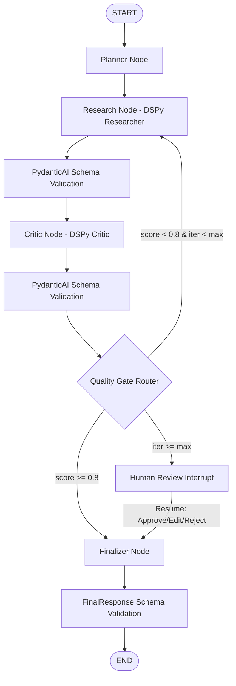

# Production-Grade Multi-Framework Agentic Orchestration System

A production-grade Python system combining **LangGraph**, **Pydantic / PydanticAI**, and **DSPy** into a unified, type-safe multi-agent orchestration architecture.

---

## Architectural Responsibility Boundaries

> **CRITICAL RULE:** Framework capabilities are strictly decoupled across clear responsibility boundaries:

```
                  +----------------------------------------------+
                  |                 LANGGRAPH                    |
                  |  Workflow Control | State | Routing | Loops  |
                  |   Checkpointing | Human-in-the-loop        |
                  +-----------------------+----------------------+
                                          |
                                          v
                  +----------------------------------------------+
                  |                    DSPY                      |
                  |  Declarative Signatures | Research Behavior  |
                  |  Critic Auditing | Metric-Driven Optimization|
                  +-----------------------+----------------------+
                                          |
                                          v
                  +----------------------------------------------+
                  |             PYDANTIC / PYDANTICAI            |
                  | Type Safety | Output Validation Boundaries   |
                  | Domain Conversion | Structured Error Recovery|
                  +----------------------------------------------+
```

| Framework | Primary Responsibilities | Components |
| :--- | :--- | :--- |
| **LangGraph** | **Workflow Control & Execution State**<br>• Node execution topology<br>• Conditional Quality Gate routing<br>• Max iteration limits & retry loops<br>• MemorySaver state checkpointing<br>• Human-in-the-loop interrupts & resumes | [`app/orchestration/graph.py`](file:///c:/Users/manas/OneDrive/Documents/RAGprojArchestration/app/orchestration/graph.py)<br>[`app/orchestration/nodes.py`](file:///c:/Users/manas/OneDrive/Documents/RAGprojArchestration/app/orchestration/nodes.py)<br>[`app/orchestration/state.py`](file:///c:/Users/manas/OneDrive/Documents/RAGprojArchestration/app/orchestration/state.py)<br>[`app/orchestration/runner.py`](file:///c:/Users/manas/OneDrive/Documents/RAGprojArchestration/app/orchestration/runner.py) |
| **Pydantic / PydanticAI** | **Type Safety & Conversion Boundaries**<br>• Strongly typed domain schemas (`Plan`, `ResearchResult`, `QualityAssessment`, `FinalResponse`, etc.)<br>• Explicit validation boundaries before downstream state updates<br>• Runtime validation error recovery | [`app/schemas/domain.py`](file:///c:/Users/manas/OneDrive/Documents/RAGprojArchestration/app/schemas/domain.py)<br>[`app/core/validation.py`](file:///c:/Users/manas/OneDrive/Documents/RAGprojArchestration/app/core/validation.py)<br>[`app/schemas/research.py`](file:///c:/Users/manas/OneDrive/Documents/RAGprojArchestration/app/schemas/research.py) |
| **DSPy** | **Declarative Behavior & Prompt Optimization**<br>• Declarative Signatures (`ResearchSignature`, `CriticSignature`)<br>• Program modules (`ResearcherModule`, `CriticModule`)<br>• Evaluation metrics (`relevance`, `completeness`, `structural_correctness`, `support_quality`)<br>• LabeledFewShot optimization compiler | [`app/dspy_lab/signatures.py`](file:///c:/Users/manas/OneDrive/Documents/RAGprojArchestration/app/dspy_lab/signatures.py)<br>[`app/dspy_lab/modules.py`](file:///c:/Users/manas/OneDrive/Documents/RAGprojArchestration/app/dspy_lab/modules.py)<br>[`app/dspy_lab/dataset.py`](file:///c:/Users/manas/OneDrive/Documents/RAGprojArchestration/app/dspy_lab/dataset.py)<br>[`app/dspy_lab/metrics.py`](file:///c:/Users/manas/OneDrive/Documents/RAGprojArchestration/app/dspy_lab/metrics.py)<br>[`app/dspy_lab/optimize.py`](file:///c:/Users/manas/OneDrive/Documents/RAGprojArchestration/app/dspy_lab/optimize.py) |

---

## Main Integrated Workflow



### Explicit Conversion Boundary Flow
```
DSPy Prediction Output
         ↓
Pydantic Schema Validation (`app/core/validation.py`)
         ↓
Validated Domain Model (`app/schemas/domain.py`)
         ↓
LangGraph State Snapshot (`app/orchestration/state.py`)
```

---

## Project Directory Structure

```
.
├── app/
│   ├── core/
│   │   ├── __init__.py
│   │   └── validation.py       # PydanticAI boundary validation & error recovery
│   ├── dspy_lab/
│   │   ├── __init__.py
│   │   ├── signatures.py       # Declarative ResearchSignature & CriticSignature
│   │   ├── modules.py          # ResearcherModule, CriticModule, & MockDSPyLM
│   │   ├── dataset.py          # 20+ dataset examples split into train/dev
│   │   ├── metrics.py          # Relevance, completeness, structure, & composite metrics
│   │   ├── evaluate.py         # DSPy Evaluate runner & report generator
│   │   └── optimize.py         # LabeledFewShot baseline vs compiled optimizer
│   ├── orchestration/
│   │   ├── __init__.py
│   │   ├── state.py            # OrchestratorState TypedDict with Pydantic domain models
│   │   ├── nodes.py            # Planner, Research, Critic, Quality Gate, Human Review, Finalizer
│   │   ├── graph.py            # StateGraph builder with MemorySaver checkpointer
│   │   └── runner.py           # OrchestrationEngine high-level invocation wrapper
│   ├── schemas/
│   │   ├── __init__.py
│   │   ├── domain.py           # Strongly typed domain models (Plan, ResearchResult, etc.)
│   │   └── research.py         # SourceType and ResearchSummary models
│   ├── config.py               # Pydantic settings & env management
│   ├── logging_config.py       # Structured JSON and text logging
│   └── main.py                 # Async entry point executing full system demos
├── tests/
│   ├── test_integrated_system.py  # 12 integrated end-to-end and failure test cases
│   ├── test_dspy_modules.py       # DSPy signatures, modules, dataset, and optimizer tests
│   ├── test_langgraph_workflow.py # LangGraph workflow, loops, and interrupt tests
│   ├── test_pydantic_schemas.py   # Pydantic validation and schema boundary tests
│   ├── test_research_agent.py     # PydanticAI research agent prototype tests
│   └── test_smoke.py              # System smoke tests
├── scripts/
│   ├── demo_full_system.py        # End-to-end integrated system demonstration
│   ├── demo_phase3.py             # DSPy declarative optimization demo
│   ├── demo_phase2.py             # LangGraph workflow demonstration
│   └── demo_phase1.py             # Phase 1 PydanticAI schema demo
├── pyproject.toml                 # Package metadata, dependencies, pytest & ruff setup
└── README.md                      # Architecture guide
```

---

## Setup & Execution Commands

### 1. Environment Setup
```bash
python -m venv .venv
.venv\Scripts\activate
pip install -e .[dev,langgraph,pydantic-ai,dspy]
```

### 2. Run Main Application Demos
```bash
.venv\Scripts\python -m app.main
```

### 3. Run Full System Demonstration Script
```bash
.venv\Scripts\python scripts/demo_full_system.py
```

### 4. Run Complete Test Suite
```bash
.venv\Scripts\python -m pytest -v
```

### 5. Run Linting and Code Quality Checks
```bash
.venv\Scripts\python -m ruff check app tests scripts
```
